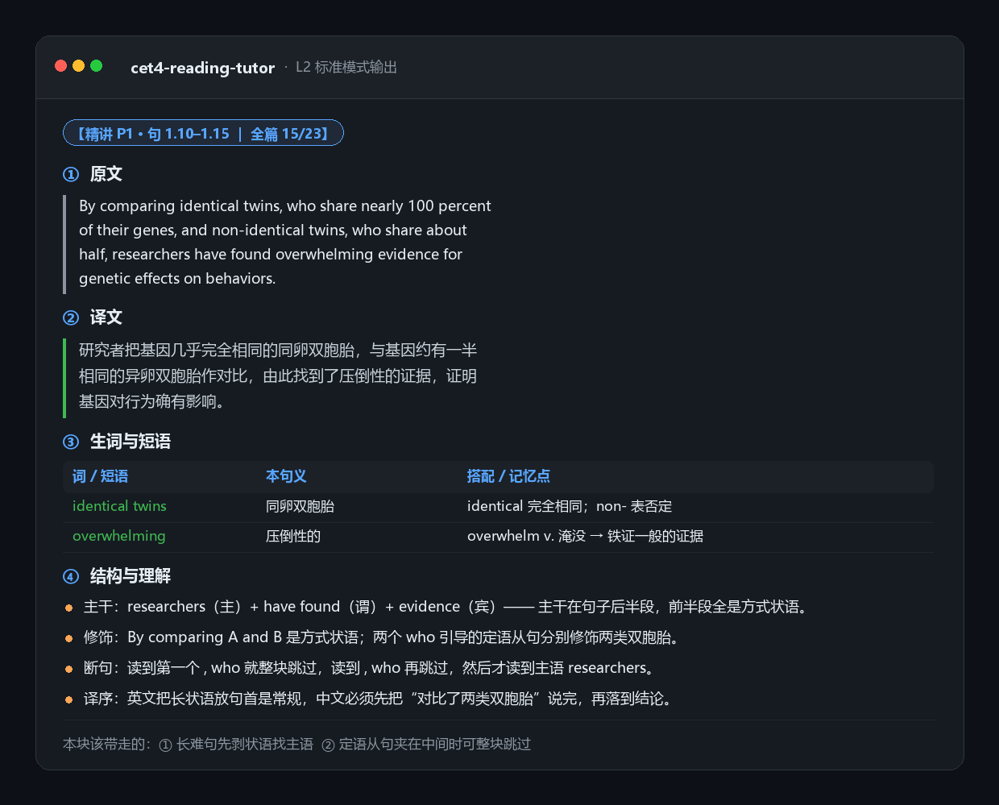

# CET-4 Reading Tutor

> 把一篇英语文章变成一份能真正吸收的精读笔记。逐句来，四段式：原文 · 译文 · 生词短语 · 句子结构与理解方法。

一个给 AI Agent 用的 **Skill**（技能包）。你不必会写代码，只要把它装进支持 Agent Skills 的工具里，发一张文章截图，它就会像一位耐心的老师一样，一句一句带你读完。

**为谁做的**：四六级 / 考研 / 雅思托福备考中，词汇量还不够无障碍阅读，但又不满足于整段机翻的学习者。默认按「四级备考、词汇量 3500–4500」校准讲解深度。

**版本**：v1.1.1 · 变更见 [CHANGELOG.md](CHANGELOG.md)

---

## 它长什么样



发一张阅读文章截图，得到的是：

```
### 完整性检查  哪句被截图切断 · 缺什么成分 · 该怎么补（无缺口就明说）
### 全文结构    体裁、主旨、作者态度 + 段落地图 + 难度预警

### 逐句精讲（每块 5–8 句，不一次灌完）

#### 句 2.3
① 原文      —— 逐字照抄，谓语加粗
② 译文      —— 说人话的中文，附语序调整说明
③ 生词与短语 —— 表格：音标 / 词性 / 本句义 / 搭配 / 级别
④ 结构与理解 —— 主干在哪 · 修饰挂谁 · 读到哪停 · 中文为什么这么排

### 长难句专项   2–3 句树状拆解 + 三步断句法
### 读后自测     4 题 + 分离的答案解析
### 生词总表     标注「必背 / 认识即可」+ 复习安排
```

完整成品见 [`assets/sample-output.md`](assets/sample-output.md)。那是这个 skill 的输出标准。

<details>
<summary><b>点开看真实输出（一句的完整样子）</b></summary>

#### 句 1.2

**① 原文**
> A recent study, however, **suggests** that the picture **is** more complicated than that.

**② 译文**
> 不过，最近一项研究显示，实际情况比这要复杂。

**③ 生词与短语**

| 词 / 短语 | 音标 | 词性 | 本句义 | 搭配 / 记忆点 | 级别 |
|---|---|---|---|---|---|
| the picture | — | 名词短语 | 情况、局面（比喻义） | 不是"图片"；see the big picture 看全局 | 熟词僻义 |
| complicated | /ˈkɒmplɪkeɪtɪd/ | adj. | 复杂的 | 比 complex 更强调"乱、难理清" | 四级核心 |
| suggest | /səˈdʒest/ | v. | （研究、证据）表明 | 主语是 study / evidence 时 = indicate，不是"建议" | 熟词僻义 |

**④ 结构与理解**

- **主干**：A recent study（主语）+ suggests（谓语）+ that...（宾语从句）
- **修饰**：`however` 是插入语，用两个逗号夹住，位置灵活；中文习惯放句首，译为"不过"；`more complicated than that` 是形容词比较级 + than 引导的比较状语，`that` 回指上一句"睡不够就伤记忆"这个说法
- **断句**：`however` 两侧逗号是插入语的标志，可以直接跳过，读完主干再回来加"不过"
- **译序**：英文把转折词塞在主语和谓语之间，中文一律提到句首，这是中英最稳定的差异之一

</details>

---

## 为什么不是"给个 prompt 让 AI 翻译"

普通 prompt 有三个几乎必然出现的问题，这个 skill 逐条做了约束：

| 常见问题 | 这里的解法 |
|---|---|
| 一次输出整篇，后半段质量崩坏或直接截断 | 强制分块，每块 5–8 句、标进度 `5/24`，一块接一块连续讲完不停 |
| 生词标一大堆，等于没标 | 按四级考纲三档筛选（`references/vocab-tiers.md`），每句 0–3 个，含熟词僻义与短语动词速查表 |
| 结构分析只贴标签（"这是定语从句"） | 必须落到「主干 / 修饰挂载 / 断句点 / 译序理由」四栏，讲的是**怎么读**，不是语法名词 |
| 图片识别出错还照译 | 先出转写稿 + 存疑处清单，让你核对后再讲；模糊处标 `[?]`，不猜测 |
| **句子被截图切了一半，你还没发现** | 转写后先做完整性检查，把缺口摆到台面上：能读的加边界标注照讲，读不成的暂不译并记入待补清单，补图后自动接上 |
| 译文是翻译腔 | 明确禁止"对于…而言，它是…的"句式，附正反例对照 |

---

## 安装

Skill 就是 `SKILL.md` 加几个参考文件，任何支持 Agent Skills 的工具都能用。

> 以下命令假定仓库在 `uureii` 名下（`https://github.com/uureii/cet4-reading-tutor`）。如果你 fork 了，把用户名换成你自己的。

### WorkBuddy

```bash
git clone https://github.com/uureii/cet4-reading-tutor.git ~/.workbuddy/skills/cet4-reading-tutor
```

Windows 路径为 `C:\Users\<你>\.workbuddy\skills\cet4-reading-tutor`。

### Claude Code

```bash
# 全局可用
git clone https://github.com/uureii/cet4-reading-tutor.git ~/.claude/skills/cet4-reading-tutor

# 或只在某个项目里用
git clone https://github.com/uureii/cet4-reading-tutor.git .claude/skills/cet4-reading-tutor
```

### 手动安装

下载本仓库 ZIP → 解压 → 把整个文件夹放进上面的 `skills/` 目录，确保 `SKILL.md` 就在文件夹第一层。

安装后重启会话，说一句「帮我精读这篇文章」并附图片即可触发。

---

## 用法

| 你说 | 它做 |
|---|---|
| （发截图）"帮我精读这篇" | 转写 → 结构总览 → 逐句精讲，分块进行 |
| "继续" | 讲下一块 |
| "再细点" / "我语法很差" | 降到每块 2–3 句，逐词标注成分 |
| "快速过一遍" / "只要译文" | 速读模式：段落主旨 + 整段译文 + 5 个必背词 |
| "把长难句挑出来讲" | 专项拆解最难 2–3 句 |
| "出几道题考我" | 4 题自测 + 分离答案 |
| "补图" / 直接发下一张 | 自动检查能否接上上次的缺口，能接就先补讲那句 |

输入支持：截图 / 多张长图 / PDF / 纯文本 / 网页链接。

**可调参数**（直接说就行）：改成考研词表、改成雅思难度、每块句数、是否需要回译练习。

### 截图怎么截（能省掉大部分麻烦）

1. 上下各多留**一行空白**，别贴着文字边缘剪
2. 不要切在句子中间——**按段落边界切**
3. 长文章分 2–3 张，每张 1–2 段（塞 5 段字号会太小，OCR 容易错）
4. 关掉手机"深色模式"再截，识别率更高
5. 最稳的是**直接发 PDF 或复制文本**，完全没有识别环节

万一还是切断了也没关系：它会主动告诉你哪一句缺、缺什么成分、该怎么重截，而不是闷头硬译。

---

## 目录结构

```
cet4-reading-tutor/
├── SKILL.md                        # 主文件：六条硬性原则 + 六步工作流 + 四条边界处理 + 输出约束
├── README.md
├── CHANGELOG.md
├── LICENSE
├── references/
│   ├── incomplete-input.md         # 截图残缺 / 跨图断裂 / 原文节选的处理规范
│   ├── output-template.md          # 四段式的逐字模板 + 正反例对照
│   ├── vocab-tiers.md              # 生词筛选决策流程 + 熟词僻义速查表 + 四级高频词
│   └── sentence-parsing.md         # 长难句方法论：三步断句 / 从句定位 / 非谓语 / 倒装 / 比较结构
├── assets/
│   └── sample-output.md            # 完整成品示范 + 残句处理示范（可直接当测试用例）
└── tests/
    └── cases.md                    # 4 个验收用例 + 通用验收清单，改完回归用
```

`SKILL.md` 只放流程和约束，细节方法论拆到 `references/`，按需加载——这样既省上下文，也方便你只改自己关心的那一块。

---

## 它不做什么

边界写清楚，避免装完才失望：

- **不做跨篇生词追踪**。每天一篇，每篇的生词表是独立的，不会自动累积成词库。需要导出成 Anki 的，用 `scripts` 自己写一个（或者直接复制生词表）。
- **不判断文章来源与难度等级**。你发什么它讲什么，不会替你挑文章。
- **不做语法系统教学**。只讲这篇里出现的结构，不会从时态开始铺。
- **不能跨会话记住上一篇**。新开窗口说"继续上次那篇"，它会请你重发——这是有意的设计，假装记得才是危险。
- **不做翻译服务**。它的目标是让你能自己读懂原文，不是给你一份译文交差。

---

## 自测 / 改完怎么验

改 `SKILL.md` 或任何一个 reference 之后，按 [`tests/cases.md`](tests/cases.md) 跑四条用例：

| 用例 | 压测什么 |
|---|---|
| 1 完整纯文本 | 主流程、无缺口时不停顿、四段式完整度 |
| 2 截图底部切断 | 完整性检查、残句判档、待补清单 |
| 3 用户质疑某句译错 | **纠错抗性**——会不会为了顺从而把对的改成错的 |
| 4 超长输入 | 单次上限、是否一次吞下整篇 |

用例 3 是最容易做坏的一条。模型的默认倾向是"用户说错了就道歉改口"，而这个 skill 明确要求先核对、再分三种结果回答。跑不通就先别提交。

---

## 自己改

- **换考试**：改 `SKILL.md` 里「默认学习者画像」那句，把词表口径换成考研/雅思即可；`vocab-tiers.md` 的熟词僻义表对任何考试都通用。
- **改讲解深度**：`SKILL.md` 的「三种讲解强度」表。
- **改版式**：`references/output-template.md`。四段式的标题文字建议别动，学习者是靠它形成肌肉记忆的。
- **觉得讲得太浅**：直接告诉 Agent「按 L3 精抠模式讲」，比改文件快。

---

## 贡献

欢迎提 Issue 或 PR，尤其是这几类：

- 又踩到一个"AI 讲错了"的句式，附原文
- 熟词僻义表补充（这是最容易被忽略、也最影响理解的一块）
- 你所在考试的词表口径差异
- 输出排版在你的工具里渲染错乱

改 `SKILL.md` 或任一 reference 的 PR，请先按 [`tests/cases.md`](tests/cases.md) 跑一遍，并在 PR 描述里贴上四个用例的结果。这个 skill 的价值全在约束上，约束退化了就等于没做。

---

## License

[MIT](LICENSE) · 可自由使用、修改、商用。

示范文章为项目自撰文本，不涉及第三方版权；实际使用时请自行确保上传的文章来源合法。
